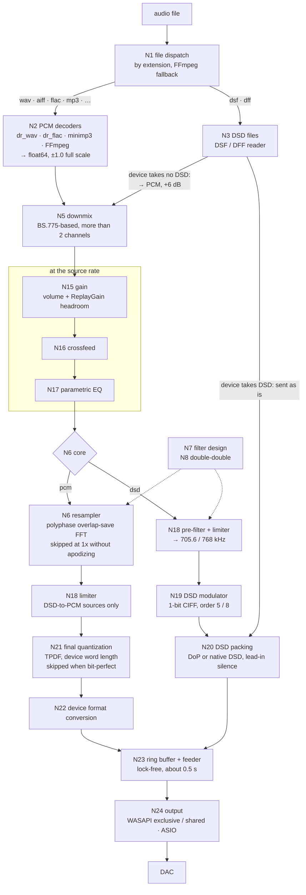

<p align="center">
  <picture>
    <source media="(prefers-color-scheme: dark)" srcset="doc/assets/icon-light.png">
    
  </picture>
</p>

<p align="center">
  <picture>
    <source media="(prefers-color-scheme: dark)" srcset="doc/assets/wordmark-light.png">
    
  </picture>
</p>

<p align="center">
  <b>A bit-perfect-first audio playback engine for Windows and macOS</b><br>
  high-precision PCM upsampling · 1-bit DSD modulation · WASAPI, ASIO and Core Audio
</p>

---

Daphne is a standalone C++20 playback engine. It decodes PCM and DSD files, runs them through a
64-bit floating-point processing chain, and sends the result to a WASAPI or ASIO device on Windows or a
Core Audio device on macOS, untouched whenever nothing in the chain needs to change a sample. It ships as a
static library, a C API library (`daphne_core.dll`, `libdaphne_core.dylib`), a command-line player and a helper
process (`daphne-helper`), and includes an extension module for the
[MIKU player](https://github.com/JIZIBABADASHA/MIKU-Player) on both systems.

## Highlights

- **Bit-perfect by construction.** A stage that would not change the signal is left out of the chain.
  With nothing to process, the samples reach the device exactly as they were decoded.
- **One filter for every upsampling path.** A Kaiser-windowed sinc low-pass, designed in double-double
  (~106-bit) arithmetic, with linear, intermediate, minimum or custom phase, optional apodizing and
  optional double-double convolution. The PCM upsampler and the DSD modulator's pre-filter use it.
- **PCM to DSD.** A CIFF delta-sigma modulator of order 5 or 8, for DSD64 to DSD1024, with
  coefficients from Schreier's NTF synthesis (order 8 at DSD64: an NTF optimized to keep 40 – 100 kHz below the
  Scarlet Book's −20 dB) and an input limiter that keeps the loop stable.
- **DSD files, three ways.** Sent as native DSD (ASIO) or DoP, or converted to PCM through a two-stage
  linear-phase low-pass (24 / 30 / 50 kHz) at +6 dB with a limiter.
- **Gapless**, across sample rates too. The next track is opened and its chain built ahead of time,
  and its ReplayGain applies exactly where it starts.
- **Settings change live.** Volume, EQ and crossfeed glide in place. A new filter is designed in the
  background and crossfaded in; designs are cached on disk.

## Signal chain

Every stage below is documented, with its measurements, in [`doc/`](doc) (N0–N25, in Chinese; open work in N26; what each platform does in edge cases in N27); the standards, papers and books each design rests on are listed in [`doc/參考文獻.md`](doc/參考文獻.md).



| Stage | What it does |
|---|---|
| **Decode** (N1–N3) | dr_wav / dr_flac / minimp3 for WAV, AIFF, FLAC and MP3; FFmpeg for everything else (AAC, ALAC, Opus, …), with MP4 gapless trimming. DSF and DFF (uncompressed) are read natively; the DSF block padding and trailing tags are never played. |
| **Downmix** (N5) | Multichannel to stereo with the ITU-R BS.775 centre / surround coefficients, plus the LFE at −6 dB (not part of BS.775) and a scale that keeps one full-scale channel from clipping. |
| **Gain** (N15) | Digital volume plus per-track ReplayGain headroom, in one gliding gain stage. |
| **Crossfeed** (N16) | Each side gets the other through a one-pole low-pass (100–3000 Hz), so a centred sound keeps its level. |
| **Parametric EQ** (N17) | Peaking, shelving, low- and high-pass biquads at the source rate, with an automatic preamp. Changes glide or crossfade. |
| **Resampler** (N6–N8) | Integer-ratio polyphase FIR upsampling to 2x, the family maximum, or a fixed rate. Taps from 16 to 1,048,576; phase from linear (α 0) to minimum (α 1); apodizing removes the recording's own ringing (pass band to 0.4535 fs, i.e. 20 kHz at 44.1 kHz). |
| **Modulator** (N18–N19) | The same filter upsamples to 705.6 / 768 kHz, a limiter keeps the input at 0.85 of the loop's stable maximum, and the 1-bit loop runs at 44.1 kHz × 64 … 1024 (one thread per channel). |
| **Quantization** (N21) | TPDF dither to the device word length, applied only when the samples were changed. No noise shaping. |
| **Output** (N23–N24) | A lock-free ring feeds the device callback. WASAPI exclusive is event-driven and negotiates the widest format the device takes; ASIO handles every PCM sample type and native DSD, reopens on driver resets, and never ends native DSD with a switch to PCM. Core Audio (macOS) plays shared or exclusive (hog mode), sets the device's rate and, exclusive, its widest integer format, and sends DSD as DoP. |

## Building

Requirements: Windows 10/11 x64, Visual Studio 2022 (C++ workload), CMake 3.25+. (The build for MIKU,
`scripts\build_for_miku.ps1`, uses them when installed and otherwise downloads a portable MSVC, CMake and Ninja into
`.tools`: `scripts\fetch_msvc.ps1`, `fetch_cmake.ps1`, `fetch_ninja.ps1`; no administrator rights needed.)

```bat
powershell -File scripts\fetch_ffmpeg.ps1    :: FFmpeg LGPL shared build (optional: without it, WAV / AIFF / FLAC / MP3 / DSD only)
powershell -File scripts\fetch_asiosdk.ps1   :: Steinberg ASIO SDK (optional: without it, no ASIO output)
scripts\build.cmd                            :: Release build + unit tests
```

The output lands in `build\bin\Release\`: `daphne.exe`, `daphne_core.dll`, `daphne_tests.exe` and the
FFmpeg DLLs. The code builds without warnings at `/W4`.

The engine, the player and the tests also build on macOS (Core Audio output, N24; `miku/pack-mac.sh` builds
the module for MIKU's Mac installer on macOS 11+ with only the Xcode command line tools: CMake and FFmpeg's source
are downloaded into `.tools` and `third_party` when missing) and on Linux (no device output there yet; the player is tested on a fake
device, [N25](doc/N25_跨平台.md)):

```sh
cmake -S . -B build -DCMAKE_BUILD_TYPE=Release && cmake --build build --parallel
ctest --test-dir build --output-on-failure
```

## Usage

**Command line**

```bat
daphne devices --probe                           :: WASAPI endpoints with their exclusive formats, ASIO drivers
daphne play --settings my.json --asio "My DAC" 01.flac 02.flac   :: gapless
daphne render-dsp in.flac out.wav --settings my.json --bits 24   :: the whole chain offline
daphne settings default my.json                  :: write the default settings
```

**Settings** are one JSON document. Every key is optional and validated, and unknown keys are reported.

```json
{
  "output": { "api": "asio", "device": "My DAC", "rate": "2x", "dsd": "auto", "max_dsd": 128 },
  "core": "pcm",
  "filter": { "taps": 32768, "phase": "minimum", "apodize": true, "double_double": false },
  "dsd_modulator": { "order": 8, "osr": 128 },
  "volume": { "mode": "digital", "db": -12.0 }
}
```

**C API** (`capi/daphne_core.h`)

```c
dc_player* p = dc_create();
char err[512];
if (dc_load(p, L"track.flac", settings_json, 0.0, 1, err, sizeof err) != DC_OK) { /* err */ }
dc_set_next(p, L"next.flac");          // gapless
/* ... dc_poll_event(p, buf, len), dc_state(p, buf, len), dc_apply(p, new_settings, err, len) ... */
dc_destroy(p);
```

## Repository layout

| Path | Contents |
|---|---|
| `platform/` | `daphne_platform`: the operating system services (threads, floating-point control, files) |
| `dsp/` | `daphne_dsp`: processing blocks, filter design, double-double arithmetic |
| `core/` | `daphne_engine`: decoders, the processing chain, device outputs, the player |
| `capi/` | `daphne_core.dll`, the C API (`dc_*`) |
| `cli/` | `daphne.exe` |
| `helper/` | `daphne-helper`: the player as a child process speaking JSON lines (used by MIKU on macOS) |
| `tests/` | Catch2 unit tests |
| `fuzz/` | libFuzzer targets for the file readers (run in CI with the sanitizers) |
| `scripts/` | Windows build scripts: `build.cmd`, `build_for_miku.ps1`, and the pinned downloads (FFmpeg, ASIO SDK, a portable MSVC / CMake / Ninja) |
| `verify/` | end-to-end measurements in Python (numpy, soundfile; live tests through a virtual cable) |
| `tools/` | `sdm_design.py`, the modulator coefficient design |
| `src/Daphne.Extension/` | the MIKU player extension module (Windows) |
| `miku/` | the same module for MIKU on macOS (a shell over `daphne-helper`); `miku/pack-mac.sh` packs it for MIKU's Mac installer |
| `doc/` | the design and verification notes, one per stage |

## Third-party software

| Component | License | Distribution |
|---|---|---|
| [dr_libs](https://github.com/mackron/dr_libs) (dr_wav, dr_flac) | Public domain / MIT-0 | in `third_party/`; dr_flac 0.13.4 with one local fix (its seek estimate converted inf / NaN to an integer, found by fuzzing; marked "Daphne (local change)") |
| [minimp3](https://github.com/lieff/minimp3) | CC0 | in `third_party/` |
| [nlohmann/json](https://github.com/nlohmann/json) | MIT | in `third_party/` |
| [Catch2](https://github.com/catchorg/Catch2) | BSL-1.0 | in `third_party/` (tests only) |
| [FFmpeg](https://ffmpeg.org) | LGPL-2.1+ | downloaded by `fetch_ffmpeg.ps1` (Windows: BtbN's n8.1.3 build, kept as the release `ffmpeg-n8.1.3-win64` of this repository) or built from its source by `miku/pack-mac.sh` (macOS), linked dynamically |
| [ASIO SDK](https://www.steinberg.net/developers/) 2.3.4 | Steinberg licence or GPLv3 (dual licensed; used under GPLv3) | downloaded by `fetch_asiosdk.ps1` (checked against its SHA-256), not redistributed |
| [GFS Didot](https://fonts.google.com/specimen/GFS+Didot) | SIL OFL 1.1 | in `src/Daphne.Extension/web/fonts/` (the wordmark) |

ASIO is a trademark and software of Steinberg Media Technologies GmbH.

## License

Copyright (C) 2026 cychang-ykc

Daphne is free software, licensed under the [GNU General Public License v3.0](LICENSE). You may use,
study, modify and redistribute it; a distributed version, modified or not, must be released under the
same license with its complete source code. The third-party components above keep their own licenses.
